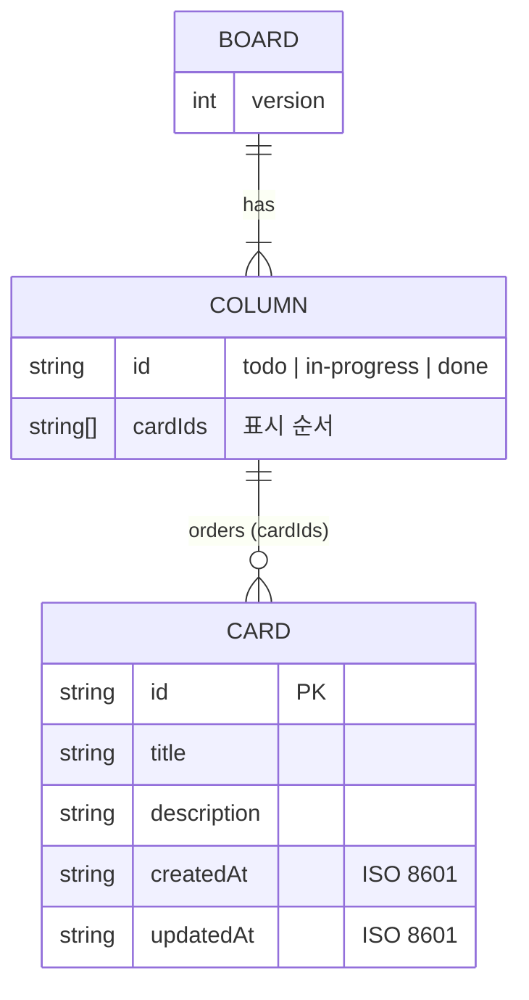

# Database Design — 칸반보드

> 기반 문서: [PLAN.md](PLAN.md) · [TRD.md](TRD.md)

서버 DB 없이 브라우저 **`localStorage`** 를 유일한 영속 저장소로 쓴다. 이 문서는 저장 키, 데이터 모델, 무결성 규칙, 마이그레이션 방침을 정의한다.

## 1. 저장소 개요

| 항목 | 값 |
|---|---|
| 저장소 | `window.localStorage` (출처별 약 5MB) |
| 키 | `kanban.board` |
| 값 | `Board` 객체를 `JSON.stringify`한 문자열 |
| 쓰기 시점 | 상태가 바뀔 때마다 전체 보드를 덮어쓴다 |
| 읽기 시점 | 앱을 초기화할 때 한 번 |

## 2. 엔티티



컬럼은 고정된 세 개이므로 별도 테이블 없이, 컬럼 id를 키로 카드 id 배열을 저장한다. 카드 본문은 `cards` 맵에 정규화해 둔다.

## 3. 스키마

### 3.1 Board

```json
{
  "version": 1,
  "cards": {
    "<cardId>": { "id": "...", "title": "...", "description": "...", "createdAt": "...", "updatedAt": "..." }
  },
  "columns": {
    "todo": ["<cardId>", "..."],
    "in-progress": [],
    "done": []
  }
}
```

### 3.2 Card 필드

| 필드 | 타입 | 필수 | 제약 |
|---|---|---|---|
| `id` | string | ✓ | 보드 안에서 고유하다. UUID v4 권장 |
| `title` | string | ✓ | trim 후 1~100자 |
| `description` | string | ✓ | 0~1000자, 없으면 `""` |
| `createdAt` | string | ✓ | ISO 8601 UTC, 생성 후 바뀌지 않는다 |
| `updatedAt` | string | ✓ | ISO 8601 UTC, 제목·설명을 바꿀 때 갱신한다. 이동할 때는 갱신하지 않는다 |

카드의 상태(컬럼)와 순서는 카드 필드가 아니라 `columns`의 배열 위치로만 표현한다. 정보가 한 곳에만 있으므로 상태와 순서가 어긋날 일이 없다.

### 3.3 예시

```json
{
  "version": 1,
  "cards": {
    "c1": { "id": "c1", "title": "요구사항 정리", "description": "", "createdAt": "2026-11-12T01:00:00.000Z", "updatedAt": "2026-11-12T01:00:00.000Z" },
    "c2": { "id": "c2", "title": "드래그 구현", "description": "Pointer Events 사용", "createdAt": "2026-11-12T01:05:00.000Z", "updatedAt": "2026-11-12T02:10:00.000Z" }
  },
  "columns": {
    "todo": ["c1"],
    "in-progress": ["c2"],
    "done": []
  }
}
```

## 4. 무결성 규칙 (`deserialize`에서 검증)

1. JSON 파싱에 실패하거나, 최상위가 객체가 아니거나, `version`이 지원 범위를 벗어나면 빈 보드를 돌려준다.
2. `columns`에 세 컬럼 키가 모두 있어야 한다. 빠진 키는 `[]`로 채우고, 모르는 키는 버린다.
3. `cards`에 없는 id를 가리키는 `cardIds` 항목은 버린다.
4. 한 카드 id가 여러 컬럼이나 한 컬럼에 중복되면 처음 나온 것만 남긴다.
5. 어느 컬럼에도 속하지 않은 카드는 `cards`에서 제거한다.
6. 필드 타입이 잘못된 카드(제목 없음 등)는 제거한다.

이 규칙 덕분에 일부만 손상된 데이터도 최대한 살려서 복구한다.

## 5. 연산과 저장 매핑

| 사용자 동작 | board.js 함수 | 바뀌는 부분 |
|---|---|---|
| 카드 추가 | `addCard` | `cards`에 추가, `columns[col]` 끝에 push |
| 편집 | `updateCard` | `cards[id]`의 title, description, updatedAt |
| 삭제 | `deleteCard` | `cards`와 해당 컬럼 배열에서 제거 |
| 드래그·메뉴 이동 | `moveCard` / `moveCardBy` | 원래 컬럼에서 빼고, 대상 컬럼의 `toIndex`에 삽입 |

연산마다 `serialize(board)` 결과를 `localStorage.setItem('kanban.board', …)`로 저장한다.

## 6. 버전과 마이그레이션

- 현재 버전은 `version: 1`이다.
- 스키마가 바뀌면 `version`을 올리고, `deserialize`에 `migrate[n → n+1]` 함수를 차례로 적용한다.
- 마이그레이션할 수 없는 미래 버전(현재보다 높음)을 만나면 덮어쓰지 않도록 읽기 전용 경고를 띄울 수 있다. 이번 범위에서는 빈 보드로 처리한다.

## 7. 용량 추정

카드 1장은 약 200B~1.3KB(설명 1000자, UTF-16 기준)다. 1,000장이어도 약 1.3MB로 한도(약 5MB) 안이다.

## 8. 테스트 데이터 시딩과 검증 (E2E)

Playwright E2E(TRD §5.3)는 실제 브라우저의 `localStorage`를 그대로 쓴다.

- **격리:** 테스트마다 새 브라우저 컨텍스트를 쓰므로 저장소가 비어 있는 상태에서 시작한다.
- **시딩:** 페이지 스크립트보다 먼저 실행되는 `page.addInitScript`로 `kanban.board` 키에 §3 스키마의 JSON을 넣는다. 헬퍼는 `seedBoard(page, layout)`이다.
  - `layout`은 `{ todo: ['a', 'b'], done: ['c'] }` 형태다. 카드 제목은 `카드 a`처럼 id를 붙여 만든다.
  - `addInitScript`는 새로고침할 때마다 다시 실행된다. 새로고침 유지 테스트에서는 시딩을 쓰지 않거나, 처음 한 번만 넣도록 sessionStorage 플래그로 막는다.
- **검증:** `page.evaluate(() => localStorage.getItem('kanban.board'))`로 저장된 값을 읽고, `columns`의 순서와 `cards` 내용을 확인한다. 헬퍼는 `readBoard(page)`다.
- **손상·실패 시뮬레이션:**
  - 손상: 잘못된 JSON 문자열을 시딩한다.
  - 쓰기 실패: `addInitScript`로 `Storage.prototype.setItem`을 덮어써 `QuotaExceededError`를 던지게 한다.
