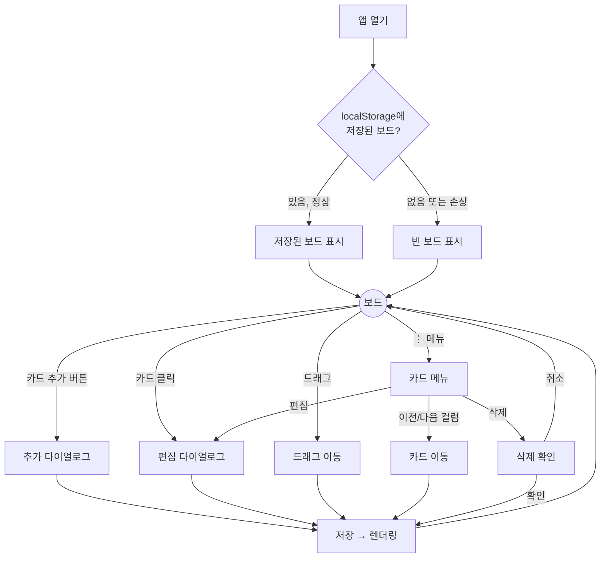
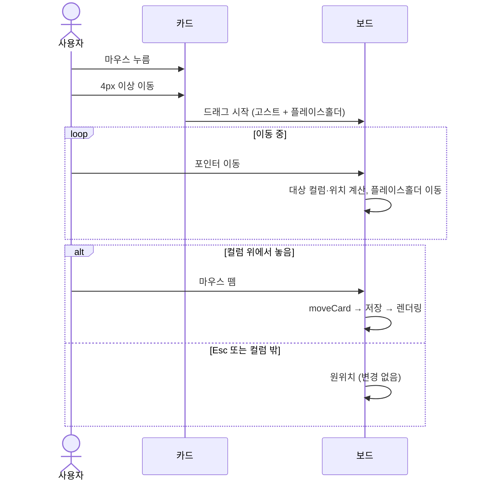

# User Flow — 칸반보드

> 기반 문서: [PLAN.md](PLAN.md) · [PRD.md](PRD.md)

## 1. 화면 구성

| 화면/요소 | 설명 |
|---|---|
| 보드 (메인) | 상단 앱 바와 세 컬럼(To-Do, In-Progress, Done). 단일 페이지다 |
| 카드 편집 다이얼로그 | 추가와 편집 모드를 같이 쓴다. 제목·설명 입력, 저장·취소 버튼 |
| 카드 메뉴 | 카드의 ⋮ 버튼으로 연다. 편집 / 이전 컬럼으로 / 다음 컬럼으로 / 삭제 |
| 삭제 확인 다이얼로그 | "이 카드를 삭제할까요?" 확인·취소 |

## 2. 전체 흐름

## 3. 세부 흐름

### 3.1 카드 추가
1. 사용자가 컬럼 하단의 **+ 카드 추가** 버튼을 누른다.
2. 다이얼로그가 "새 카드 — {컬럼명}" 제목으로 열리고 제목 입력란에 포커스가 간다.
3. 제목과 설명을 입력하고 **저장**(또는 `Enter`)을 누른다.
   - 제목이 비어 있으면 입력란 아래에 "제목을 입력해 주세요."가 표시되고 다이얼로그는 열려 있다.
4. 다이얼로그가 닫히고, 카드가 해당 컬럼 맨 아래에 추가된다. 카운트 배지가 1 늘어난다.
5. **취소**, `Esc`, 배경 클릭으로 닫으면 아무것도 바뀌지 않는다.

### 3.2 카드 편집
1. 카드 본문을 클릭(탭)하거나 메뉴에서 **편집**을 고른다.
2. 다이얼로그가 기존 값이 채워진 채 열린다.
3. 저장하면 카드 내용이 바뀌고 위치는 그대로다.

### 3.3 카드 삭제
1. 메뉴에서 **삭제**를 고른다.
2. 확인 다이얼로그에서 **삭제**를 누르면 카드가 사라지고 배지가 1 줄어든다.

### 3.4 드래그 이동 — 데스크톱(마우스)

### 3.5 드래그 이동 — 모바일(터치)
1. 카드를 **약 200ms 길게 누른다**.
   - 그 전에 손가락을 움직이면 일반 스크롤로 처리된다.
2. 드래그가 시작되면 카드가 살짝 떠오르고(엘리베이션 증가), 원래 자리에 플레이스홀더가 생긴다.
3. 손가락을 따라 카드가 움직인다. 화면 위아래 끝에 가까워지면 보드가 자동으로 스크롤된다.
4. 원하는 위치에서 손을 떼면 이동이 끝난다.

### 3.6 메뉴로 이동 (키보드·접근성)
1. `Tab`으로 카드의 ⋮ 버튼에 포커스하고 `Enter`를 누른다.
2. 화살표 키로 **다음 컬럼으로**를 고르고 `Enter`를 누른다.
3. 카드가 다음 컬럼 맨 아래로 이동하고, 이동한 카드의 ⋮ 버튼으로 포커스가 돌아온다.
   - To-Do에서는 "이전 컬럼으로", Done에서는 "다음 컬럼으로"가 비활성화된다.

## 4. 예외 흐름

| 상황 | 처리 |
|---|---|
| 저장 데이터 손상 | 빈 보드로 시작한다. 손상된 데이터는 다음 저장 때 덮어쓴다 |
| `localStorage` 사용 불가(사생활 보호 모드 등) | 메모리로만 동작한다. 새로고침하면 사라진다 |
| 드래그 중 `pointercancel`(전화 수신 등) | 원위치로 되돌리고 변경하지 않는다 |
| 같은 자리에 놓음 | 상태가 바뀌지 않으므로 저장하지 않는다 |

## 5. E2E 시나리오 매핑 (Playwright)

이 문서의 흐름은 Playwright E2E 테스트로 자동 검증한다. 구성은 TRD §5.3에 있다. 시나리오는 test first(Red → Green → Refactor)로 작성한다.

| ID | 대상 흐름 | 검증 내용 | spec 파일 | 프로젝트 |
|---|---|---|---|---|
| E2E-01 | §2 전체 흐름(앱 열기) | 빈 보드에 세 컬럼과 0개 배지가 보인다. 시딩한 보드가 순서대로 복원된다. 추가 후 새로고침해도 유지된다 | `board.spec.js` | desktop |
| E2E-02 | §3.1 카드 추가 | 컬럼 버튼으로 다이얼로그가 열리고 제목에 포커스가 간다. Enter로 저장하면 맨 아래에 추가되고 배지가 늘어난다. 빈 제목은 오류를 보이고 다이얼로그가 유지된다. 취소·Esc·배경 클릭은 변경이 없다. 모바일 FAB는 To-Do에 추가한다 | `card-crud.spec.js` | desktop, mobile |
| E2E-03 | §3.2 카드 편집 | 카드를 클릭하면 기존 값이 채워진다. 저장하면 내용만 바뀌고 위치는 그대로다. 포커스한 카드에서 Enter로도 편집이 열린다 | `card-crud.spec.js` | desktop, mobile |
| E2E-04 | §3.3 카드 삭제 | 메뉴 → 삭제 → 확인하면 카드가 사라지고 배지가 줄어든다. 취소하면 그대로다 | `card-crud.spec.js` | desktop, mobile |
| E2E-05 | §3.4 마우스 드래그 | 컬럼 간 이동(맨 앞, 사이, 맨 끝), 빈 컬럼으로 이동, 같은 컬럼 내 재정렬이 된다. 드래그 중 고스트와 플레이스홀더가 보인다. Esc나 보드 밖에 놓으면 원위치된다. 드래그 뒤 편집 다이얼로그가 열리지 않는다 | `drag-mouse.spec.js` | desktop |
| E2E-06 | §3.5 터치 드래그 | 롱프레스(200ms 이상) 후 끌면 이동한다. 롱프레스 전에 움직이면 드래그되지 않는다(스크롤). 짧게 탭하면 편집이 열린다 | `drag-touch.spec.js` | mobile |
| E2E-07 | §3.6 키보드 메뉴 이동 | Tab으로 ⋮에 포커스하고 Enter로 메뉴를 연다. 화살표로 "다음 컬럼으로"를 고르고 Enter를 누르면 이동하고, 포커스가 ⋮로 돌아오고, `aria-live`로 알린다. 경계 컬럼에서는 항목이 비활성화된다 | `keyboard.spec.js` | desktop |
| E2E-08 | §4 예외 흐름 | 손상된 저장 데이터면 빈 보드로 시작한다. `localStorage` 쓰기가 실패해도 화면은 동작한다. 같은 자리에 놓으면 저장하지 않는다 | `resilience.spec.js` | desktop |
| E2E-09 | DESIGN_SYSTEM §6 반응형 | 360·768·1280px에서 레이아웃이 기대대로다. 세부 기준은 DESIGN_SYSTEM §8에 있다 | `responsive.spec.js` | desktop, mobile |
| E2E-10 | DESIGN_SYSTEM §2, §7 | 다크모드 색상, 포커스 링, 모션 줄이기를 확인한다 | `theme-a11y.spec.js` | desktop |
